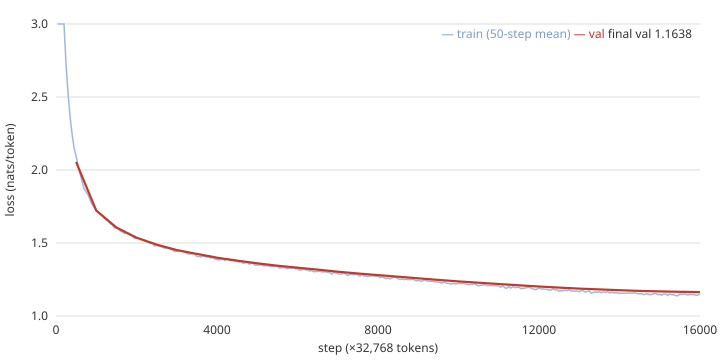

# 사전학습 (Stage 3)

전체 계획은 [로드맵](../2026-10-21-roadmap.md), 학습 대상 모델은 [Decoder-only GPT](2026-10-21-gpt-model.md) 참고. 이 페이지는 `scratchlm/data.py`, `scratchlm/optim.py`, `scratchlm/train.py`를 원리 중심으로 설명한다. 옵티마이저와 LR 스케줄은 `torch.optim` 없이 직접 썼다.

## 1. 사전학습이란

raw text 위에서 **다음 토큰 예측**(next-token prediction)을 푸는 것이 전부다. 라벨은 텍스트 자체(입력을 한 칸 민 것)이므로 사람의 주석이 필요 없다. 한 윈도우(512 토큰)에서 512개의 학습 신호가 동시에 나온다.

모델이 배우는 것은 `P(다음 토큰 | 앞의 모든 토큰)`이고, 이를 잘 맞히려면 철자와 어휘, 문법, 이야기의 전개(주인공 이름을 유지하고 이야기를 끝맺는 것)를 모두 압축해야 한다. 명시적으로 가르치는 규칙은 없다.

**loss, perplexity, bits per byte**:

```
loss        = mean( -ln p(정답 토큰) )              단위 nat (자연로그 기준)
perplexity  = e^loss                                 "매 위치에서 평균 몇 개 중 헷갈리는가"
bits/token  = loss / ln 2
bits/byte   = loss / ln 2 / (bytes/token)            bytes/token = 4.08 (측정, 2절)
```

초기 모델은 거의 균등 분포라 loss가 `ln 8192 = 9.011`(GPT 페이지 7절) 근처다. perplexity로는 약 8192, 즉 "8192개 중 아무거나"다. loss가 2.2면 perplexity 약 9다. bits per byte는 토크나이저가 달라도 비교할 수 있는 단위다. 토큰이 길수록 토큰당 loss는 커지기 때문에 byte로 나누어 정규화한다.

## 2. 데이터 파이프라인 (`data.py`)

**준비 (`prepare`)**:

1. 텍스트를 `<|endoftext|>`로 나누고 `strip()`한 뒤 빈 문서를 버린다.
2. 문서를 2000개씩 chunk로 묶어 `multiprocessing.Pool(16)`에서 인코딩한다. 각 worker는 `_init`에서 토크나이저를 한 번만 로드한다. 문서마다 끝에 `<eot>` id를 붙인다.
3. `pool.imap`은 **입력 순서대로** 결과를 돌려주므로(`imap_unordered`와 다르다), 결과를 받는 대로 파일에 이어 쓰면 문서 순서가 보존된다.
4. 전체가 **하나의 평평한 uint16 배열**이다: `doc_1 <eot> doc_2 <eot> ...`.

**왜 uint16인가**: vocab 8192는 `2^16 = 65536`보다 작아서 id가 2바이트에 들어간다. int32의 절반이고 (536M 토큰 x 2바이트 = 약 1.07 GB, 계산값) 디스크에서 곧바로 `np.memmap`으로 연다. 상한은 `vocab_size <= 65536`이다.

**batch 샘플링 (`batches`)**:

```
starts = rng.integers(0, len(data) - ctx_len - 1, batch)       # 균등 랜덤 시작점
w      = stack([ data[s : s + ctx_len + 1] for s in starts ])  # (B, ctx_len+1)
x, y   = w[:, :-1], w[:, 1:]                                   # y는 x를 한 칸 민 것
```

- 길이가 `ctx_len + 1`인 이유: 입력 512개에 대응하는 정답 512개를 만들려면 513개가 필요하다. `test_batches_are_shifted_windows`가 `y == x + 1`(arange shard)로 확인한다.
- 시작점은 문서 경계를 무시한다. **window가 `<eot>`를 가로지를 수 있고**, 그러면 모델은 `<eot>` 뒤에 새 이야기가 시작된다는 것까지 배운다. 문서를 패딩해 맞추지 않으므로 낭비되는 토큰이 없다.
- 샘플링은 복원 추출이라 "epoch" 경계가 없다. 총 토큰 수 / shard 토큰 수를 epoch처럼 환산할 뿐이다.
- CUDA에서는 `pin_memory().to(device, non_blocking=True)`로 page-locked 메모리에서 비동기 복사한다. 단, 윈도우 조립은 학습 루프와 같은 프로세스에서 순차로 하므로 복사만 겹친다.
- int64로 바꾸는 이유: 임베딩 lookup과 `cross_entropy`의 인덱스가 int64를 기대한다.

**측정 (PGX)**:

| shard | 문서 수 | 토큰 수 | 비고 |
|---|---|---|---|
| train | 2,717,495 | 536,358,234 | `<eot>` 포함 |
| val | 27,630 | 5,416,419 | |

- bytes/token = **4.08** (`prepare`가 출력: 문서 UTF-8 byte 합 / 토큰 수, `<eot>`도 토큰에 포함).
- 전체 인코딩 약 **20초** (16 workers). TinyStories는 어휘가 작아서 토크나이저의 chunk cache가 잘 맞아 빠르다.

## 3. AdamW (`optim.py`)

파라미터마다 기울기 `g`의 지수이동평균(EMA) 두 개를 들고 간다.

```
m = b1·m + (1-b1)·g        1차 moment (방향, 모멘텀)
v = b2·v + (1-b2)·g²       2차 moment (크기의 제곱)
```

코드는 같은 식을 lerp 형태로 쓴다: `m.lerp_(g, 1-b1)`는 `m + (1-b1)(g - m)`이라 `b1·m + (1-b1)·g`와 같다. 기본값은 `betas=(0.9, 0.95)`, `eps=1e-8`, `weight_decay=0.1`이다. `b2=0.95`면 `v`의 기억이 약 20 step이라 기울기 크기 변화에 빨리 반응한다 (0.999면 약 1000 step).

**bias correction**: `m`, `v`는 0에서 시작하므로 초반에 0쪽으로 치우친다. `g`가 항상 같다면 `m_t = (1 - b1^t)·g`이므로

```
m_hat = m / (1 - b1^t),    v_hat = v / (1 - b2^t)       (코드: c1, c2)
p -= lr · m_hat / ( sqrt(v_hat) + eps )
```

`t = 1`이면 `m_hat = g`, `v_hat = g²`라 한 걸음이 정확히 `lr·sign(g)`다. 보정이 없으면 `m/sqrt(v) = 0.1g / sqrt(0.05)|g| = 0.447`로 첫 걸음이 작아지는 식으로 초반 크기가 어긋난다. `t`가 커지면 `b^t -> 0`이라 보정이 1로 수렴한다. 즉 보정은 **t가 작을 때만** 의미가 있다. 코드에서 `eps`는 보정 후 `sqrt(v_hat)`에 더한다.

**한 coordinate의 걸음 크기는 대략 `lr`**: 기울기가 일관되면 `|m_hat| ~ sqrt(v_hat)`라 비율이 1 근처이고, 기울기가 잡음이면 `m`이 상쇄되어 비율이 1보다 작다. 기울기의 절대 크기(레이어마다 수십 배 다를 수 있다)가 약분되므로, 하나의 `lr`로 모든 파라미터를 다룰 수 있다. `eps`는 `v_hat ~ 0`일 때 0으로 나누는 것을 막는다.

**decoupled weight decay (AdamW)**: 두 방식을 비교한다.

```
L2 (Adam)   : g' = g + wd·p  -> m, v를 거쳐 p -= lr · (m/sqrt(v))     decay도 1/sqrt(v)로 나뉜다
AdamW       : p -= lr · wd · p   (코드: p.mul_(1 - lr·wd)),  Adam 걸음은 g만 사용
```

L2를 기울기에 넣으면 `wd·p` 항이 `sqrt(v)`로 나뉘어, 기울기가 큰(`v`가 큰) 파라미터는 덜 줄어들고 작은 파라미터는 더 줄어든다. 정규화 강도가 기울기 통계에 휘둘리는 것이다. AdamW는 decay를 분리해 모든 가중치가 `lr·wd`의 같은 비율로 줄어든다 (`lr=1e-3`, `wd=0.1`이면 step당 `1e-4`). 코드의 순서는 decay 먼저(`p.mul_`), 그 다음 Adam 걸음이다.

**decay 대상은 `p.ndim >= 2`만**: 행렬(Linear, Embedding)만 decay하고 RMSNorm의 gain `g`(1차원)는 decay하지 않는다. gain은 1에서 출발해 활성값의 스케일을 정하는 값이라 0으로 끌면 안 된다. **tied embedding은 2차원이므로 decay된다** (출력 행렬로도 쓰이는 가중치다).

**테스트**: `test_adamw_matches_torch`는 (5,3) 행렬과 (3,) 벡터를 20 step 학습(중간에 lr 반감)해 `torch.optim.AdamW`(행렬은 wd 0.1, 벡터는 0)와 `assert_close`로 일치함을 확인한다. `torch.optim`은 **테스트에서만** 쓴다. `test_state_dict_roundtrip`은 `t`, `m`, `v`가 저장/복원됨을 확인한다 (resume에 필수).

## 4. LR 스케줄: warmup + cosine

```
step < warmup :  lr = max_lr · (step+1) / warmup
그 외          :  progress = min(1, (step - warmup) / max(1, total - warmup))
                 lr = max_lr · ( min_ratio + (1 - min_ratio) · 0.5 · (1 + cos(pi · progress)) )
```

- warmup 첫 step의 lr은 `max_lr/warmup`이고, `step = warmup-1`에서 `max_lr`에 도달한다.
- cosine은 `progress=0`에서 `max_lr`, `progress=1`에서 `min_ratio·max_lr`다. 중간(`progress=0.5`)은 `(1 + min_ratio)/2 · max_lr`이다.
- 테스트(`max_lr=1, warmup=10, total=100`): step 0 -> 0.1, step 9 -> 1.0, **step 55 -> 0.55** (`progress = 45/90 = 0.5`이므로 `0.1 + 0.9·0.5·(1+cos(pi/2)) = 0.55`), step 100 -> 0.1.

**왜 warmup인가**: 초반에는 `v`가 몇 개의 기울기만 반영한 잡음 섞인 추정이라, 어떤 coordinate의 `sqrt(v_hat)`는 실제 크기보다 훨씬 작을 수 있다. 그러면 분모가 작아 걸음이 `lr`보다 크게 튀고, 아직 아무것도 배우지 않은 가중치에 큰 업데이트가 들어가 발산하거나 나쁜 영역에 갇힌다. lr을 0 근처에서 키우는 동안 `v`가 안정되고 모델이 어느 정도 형태를 갖춘다. 끝에서 lr을 `0.1·max_lr`까지 줄이는 이유는 후반에 큰 걸음이 만드는 진동을 없애 loss를 한 단계 더 낮추기 위해서다.

## 5. Gradient clipping

```
norm  = sqrt( sum over all params of ||g||² )          전체 파라미터를 하나의 벡터로 본 L2 norm
scale = min(1, max_norm / (norm + 1e-6))
g    *= scale                                           방향은 보존, 크기만 줄임
```

기울기가 `max_norm=1.0`을 넘을 때만 전체를 균일하게 줄인다 (그 밑이면 `scale=1`). 코드는 `norm`과 `scale`을 **텐서로** 계산한다: `if norm > max:` 같은 파이썬 분기는 GPU 값을 CPU로 가져오는 동기화(sync)를 일으켜 매 step 파이프라인을 멈추기 때문이다. `clamp(max=1.0)`으로 분기 없이 같은 결과를 얻는다. 반환값은 clip **이전**의 norm이고 로그의 `grad_norm`이 이 값이다. `test_clip_grad_norm`은 `sqrt(27 + 16)`을 반환하고 clip 후 norm이 1.0임을 확인한다.

## 6. 학습 루프 (`train.py`)

**설정 (기본값)**:

| 항목 | 값 |
|---|---|
| batch x ctx | 64 x 512 = **32,768 tokens/step** (`accum=1`) |
| lr / warmup / min_lr_ratio | 1e-3 / 500 / 0.1 |
| weight decay / betas / clip | 0.1 / (0.9, 0.95) / 1.0 |
| eval_every / eval_batches / ckpt_every | 500 / 20 / 1000 |
| 정밀도 / compile | bf16 autocast / `torch.compile` |

**step 하나**:

```
lr = cosine_lr(step, ...)
for _ in range(accum):
    loss = fwd(x, y)               # bf16 autocast
    (loss / accum).backward()      # 기울기가 누적됨
clip_grad_norm -> opt.step(lr) -> opt.zero_grad()
```

- **gradient accumulation**: micro-batch의 loss는 토큰 평균이므로 `loss/accum`을 backward하면 누적된 기울기가 "큰 batch 전체의 평균 loss"의 기울기가 된다 (사전학습에는 무시 토큰이 없어 micro-batch마다 토큰 수가 같다). 메모리가 모자랄 때 batch를 쪼개도 같은 최적화가 된다.
- **bf16 autocast**: matmul만 bf16이고 파라미터, 옵티마이저 상태(`m`, `v`), loss는 fp32다 (GPT 페이지 3, 9절).
- **torch.compile**: 학습 forward와 eval(`evaluate(fwd, val)`)은 컴파일된 `fwd`를 쓴다. 샘플 생성(`model.generate`)은 **컴파일하지 않은 원래 모델**이다. KV cache가 매 토큰 길어져 입력 shape이 계속 바뀌므로 컴파일 대상으로 부적합하다 (shape마다 재컴파일). 두 모델은 같은 파라미터를 공유한다.
- **고정 validation set**: `seed=12345`로 20개 batch(각 64 x 512)를 한 번 뽑아 두고 eval 때마다 재사용한다. 그래야 step 사이, run 사이 val loss가 같은 데이터에서의 값이라 비교 가능하다. 평균은 20개 batch loss의 단순 평균이다.
- **로깅**: 50 step마다 `runs/<name>/log.jsonl`에 JSON 한 줄(`loss`, `lr`, `grad_norm`, `tok_s`, `mfu`)을 쓴다. `loss_sum`을 GPU 텐서로 누적(`loss.detach()/accum`)하고 50 step 뒤에만 `.item()`해서 매 step 동기화를 피한다. `loss`는 직전 50 step의 평균이고 `lr`, `grad_norm`은 그 50번째 step의 값이다. eval 줄에는 `val`과 샘플 텍스트(`temperature 0.8, top_k 50`, 120 토큰, 프롬프트 "Once upon a time")가 들어간다. eval 직후 `t0`를 리셋해 eval 시간은 처리량에서 뺀다 (체크포인트 저장 시간은 다음 창에 섞인다).
- **atomic 체크포인트**: `ckpt.pt.tmp`에 쓴 뒤 `os.replace`로 바꾼다. 쓰는 도중 죽어도 이전 체크포인트가 온전하다. 내용은 모델, 옵티마이저(`t`, `m`, `v`), step, model_config다.
- **resume**: `ckpt.pt`가 있으면 모델/옵티마이저/step을 복원한다. `opt.t`도 복원되므로 bias correction이 이어진다. 데이터 seed는 `seed + start`로 바꿔서 이전과 같은 window를 반복하지 않는다. 따라서 중단-재개한 run은 끊김 없는 run과 batch 순서가 다르다. 컴파일은 다시 한다.

**MFU** (model FLOPs utilization):

```
FLOPs/token = 6N + 12·L·T·d          (코드: flops_per_token)
MFU         = tok/s · FLOPs/token / 68e12
```

`6N`은 forward 2N + backward 4N이고, `12·L·T·d`는 파라미터에 없는 attention 점수 행렬곱 비용이다 (small: `6·29.9M ≈ 179.4M`, `12·8·512·512 ≈ 25.2M`, 합 약 0.204 GFLOP/token). 분모 68e12는 데이터시트 피크가 아니라 0단계에서 **측정한 GB10의 bf16 matmul**이다.

## 7. 측정: smoke run (300 step, warmup 50)

| 항목 | 값 |
|---|---|
| 처리량 (`torch.compile`) | **141.8k tok/s**, MFU **0.426** |
| 처리량 (eager, 2단계 측정) | 56.3k tok/s (약 **2.5배** 차이) |
| 첫 50 step 창 | 73k tok/s (compile 시간 포함) |
| val loss | step 150: 2.6276, step 300: **2.2091** (300 x 32,768 = 약 9.8M 토큰) |

- eager 56.3k는 2단계 벤치마크(B=16, SDPA, bf16)의 값이라 batch 크기가 다르다. 2.5배는 대략적 비교다. 향상의 원인은 `torch.compile`이 RMSNorm, RoPE, SiLU 같은 elementwise 연산을 fuse해 메모리 왕복을 줄인 것이다 (GPT 페이지 11절의 예측과 일치).
- 첫 창의 73k는 compile이 `t0` 측정 구간 안에 들어가기 때문이다. 정상 처리량은 이후 창에서 본다.
- val loss를 perplexity와 bits per byte로 바꾸면 (계산값): step 150은 `e^2.6276 ≈ 13.8`, step 300은 `e^2.2091 ≈ 9.1`, `2.2091 / ln2 / 4.08 ≈ 0.78 bits/byte`.
- step 300의 샘플: *"Once upon a time, there was a little girl named Amy. Amy loved to spend more adventures in the sun. She would swing, jump, and zoom around the big field."* 문장 구조와 이야기 틀은 잡혔지만 "spend more adventures"처럼 어색한 조합이 남아 있다. 9.8M 토큰만 본 모델의 수준이다.
- **resume 시험**: step 300에서 재개해 400까지 진행했고 val은 2.1108이다. 재개 후 lr이 끊김 없는 run과 다르게 보이는 것은 시험에서 `--steps`를 300에서 400으로 바꿨기 때문이다. 총 step이 바뀌면 cosine의 `progress`가 달라진다 (resume 로직 때문이 아니다).

## 8. 본 학습 결과



`runs/small` (PGX, 2026-10-21): 16,000 step, 524M 토큰, 실제 소요 약 **63분** (14:19 → 15:22, 예상 62분과 거의 일치).
처리량 중앙값 **141.3k tok/s, MFU 0.425**로 처음부터 끝까지 일정했다.

| step | 토큰 | val loss | perplexity (e^loss) |
|---|---|---|---|
| 500 | 16M | 2.0546 | 7.8 |
| 1,000 | 33M | 1.7229 | 5.6 |
| 2,000 | 66M | 1.5362 | 4.6 |
| 4,000 | 131M | 1.3995 | 4.1 |
| 8,000 | 262M | 1.2801 | 3.6 |
| 12,000 | 393M | 1.2021 | 3.3 |
| 16,000 | 524M | **1.1638** | **3.2** |

- **최종 val 1.1638 = 0.41 bits/byte** (1.1638 / ln2 / 4.08). 1.5단계 numpy MLP(8바이트 문맥) 2.18 bits/byte의 약 1/5.
- 마지막 train loss 1.1489 vs val 1.1638: 차이 0.015 → 과적합 없음 (데이터를 약 1회만 봄).
- 후반의 감소: step 8,000 → 16,000에서도 0.116 내려갔다. 학습률이 cosine으로 1e-3 → 1e-4로 줄면서 잡음이 줄고 더 정밀하게 수렴한다.
  다만 마지막 1,000 step의 개선은 0.0045로 거의 평탄 → 이 크기·데이터에서 더 학습해도 효과는 작다 (같은 데이터 2 epoch나 base 91M이 다음 실험 후보).
- grad norm은 초기 1.8 → 중반 0.24 → 끝 0.29. 스파이크 없음.
- 체크포인트 `runs/small/ckpt.pt` 359MB (모델 fp32 120MB + AdamW m, v 각 120MB).

최종 샘플 (step 16,000, temperature 0.8, top-k 50, 프롬프트 "Once upon a time"):

> Once upon a time, there was a little boy named Tim. Tim lived in a small house near the woods. One day, he went outside to play with his ball. He saw a big tree and decided to throw his ball up high in the air.
> As the ball fell, a strong wind started to blow. The wind was very harsh and blew the ball up, up, up into the sky. Tim was sad because the ball was gone. He looked everywhere for his ball, but he could not find it.
> Then, a friendly squirrel saw Tim and wanted to help. The squirrel found the ball

3,000 step 샘플에 있던 문장 반복이 사라지고, 사건 → 문제 → 도움이라는 이야기 구조가 유지된다.

### 계획 (측정 전)

- **16,000 step x 32,768 = 524M 토큰**. train shard 536M 토큰의 약 **0.98 epoch**.
- 예상 시간 약 **62분** (추정값: 524M / 141.8k tok/s ≈ 3,700초. eval, 체크포인트, compile 시간 제외).
- 복원 추출이므로 0.98 epoch이라도 모든 토큰을 정확히 한 번씩 보는 것은 아니다. 일부 구간은 여러 번, 일부는 한 번도 안 보게 된다.

## 9. loss 곡선 읽는 법

- **train vs val**: 두 값이 거의 붙어 있으면 모델이 데이터를 외우는 게 아니라 일반화하는 중이다. 이 run은 shard를 1 epoch도 안 돌므로 같은 window를 거의 반복해 보지 않아서 train과 val이 가깝게 움직이는 것이 정상이다. val이 train보다 계속 크게 위로 벌어지면 과적합 신호다. train loss는 50 step 평균, val은 고정 20 batch 평균이라 약간의 측정 방식 차이는 있다.
- **plateau**: 초반에 "다음 토큰 빈도" 수준에서 한참 정체했다가 내려가는 구간이 흔하다 (문법이나 이야기 구조 같은 능력이 한 번에 생기는 지점). lr이 너무 낮아도 plateau처럼 보인다.
- **spike**: loss가 갑자기 튀는 것은 나쁜 batch나 `v`가 작아진 coordinate에 큰 걸음이 들어갈 때 생긴다. 보통 `grad_norm`이 먼저 튄다. `clip=1.0`은 이 크기를 억제해 회복을 돕는다. 로그의 `grad_norm`이 1을 넘으면 그 step은 clip된 것이다.
- **grad_norm**: 학습 초반에 크고 점차 안정되는 모양이 일반적이다. warmup을 끄거나 lr이 너무 높으면 초반에 크게 출렁인다. 후반에 서서히 변하는 것은 lr 감소와 함께 정상이다. 절대값은 이번 본 학습 결과에서 확인한다.
- **TinyStories의 val loss가 낮은 이유**: 어린이용 짧은 이야기라는 좁은 도메인이다. 어휘가 작고(vocab 8k로도 충분) 문장 틀과 주인공/사건 구조가 반복적이라 다음 토큰의 불확실성 자체가 낮다. 같은 loss 숫자를 일반 웹 텍스트의 loss와 비교하면 안 된다. 비교는 같은 데이터, 같은 토크나이저에서만 의미가 있다 (토크나이저가 다르면 bits per byte).

## 10. 참고 구현 비교 표

나중에 Karpathy의 microgpt, nanoGPT, nanochat과 비교할 예정이다. 이 코드의 선택만 기록하고 참고 구현 열은 비워 둔다.

| 설계 선택 | 이 코드 | 참고 구현 |
|---|---|---|
| 옵티마이저 | AdamW, betas (0.9, 0.95), eps 1e-8 | 나중에 비교 (TBD) |
| weight decay | 0.1, `ndim >= 2` 행렬에만 (norm gain 제외, tied embedding 포함) | 나중에 비교 (TBD) |
| LR 스케줄 | 선형 warmup 500 step + cosine, 최소 0.1 x max_lr | 나중에 비교 (TBD) |
| 최대 lr | 1e-3 | 나중에 비교 (TBD) |
| gradient clip | 전체 L2 norm 1.0 | 나중에 비교 (TBD) |
| 정밀도 | bf16 autocast (파라미터/옵티마이저 fp32) | 나중에 비교 (TBD) |
| 컴파일 | `torch.compile` (학습, eval) | 나중에 비교 (TBD) |
| 데이터 샘플링 | uint16 shard + 랜덤 window (복원 추출, `<eot>` 가로지름) | 나중에 비교 (TBD) |
| batch | 64 x 512 = 32,768 tokens/step | 나중에 비교 (TBD) |

## 11. 실습

1. **warmup 끄기**: `--warmup 1`로 초반 200 step의 loss와 `grad_norm`을 기본값(500)과 비교하라. 4절의 설명대로 초반에 출렁이는가? 출렁인다면 `v`의 어떤 성질 때문인가?
2. **weight decay 0 대 0.1**: 같은 설정으로 `--wd 0`과 `--wd 0.1`을 돌려 val loss를 비교하라. 효과가 보이는 시점은 언제인가? 1 epoch 미만의 학습에서 decay가 하는 일은 무엇일지 예상부터 적어 보라.
3. **accum 대 batch**: `--batch 32 --accum 2`와 `--batch 64 --accum 1`이 같은 최적화인지 확인하라. 같은 입력을 넣었을 때 첫 step의 loss가 같은지 (bf16 오차 안에서), 두 설정의 처리량은 얼마나 다른지 본다. 두 설정이 같은 window를 뽑는다는 보장은 없으므로 고정 batch로 비교하라.
4. **compile on/off**: `--compile false`로 처리량과 MFU를 재고 7절의 141.8k, 0.426과 비교하라. 첫 창의 compile 시간은 얼마인가?
5. **lr sweep**: 3e-4, 1e-3, 3e-3으로 1000 step씩 돌려 val loss와 `grad_norm`을 비교하라. 너무 큰 lr에서는 어떤 모양이 되는가? (`--steps 1000`을 주면 cosine이 그 길이에 맞춰진다는 점에 유의.)

## 12. 실행

```bash
# 토큰 shard 만들기 (val shard도 같은 방식으로 data/ts_val.bin에)
scripts/pgx.sh python -m scratchlm.data data/TinyStoriesV2-GPT4-train.txt data/tok8k.json data/ts_train.bin

# 본 학습 (백그라운드, 컨테이너 이름 pretrain-small)
DETACH=pretrain-small scripts/pgx.sh python -m scratchlm.train --name small --steps 16000

# 로그 보기
ssh pgx docker logs -f pretrain-small
```

같은 명령을 다시 실행하면 `runs/small/ckpt.pt`에서 이어서 학습한다 (모델, 옵티마이저 `t/m/v`, step 복원). 로그는 `runs/small/log.jsonl`에 이어 붙는다. 처음부터 다시 하려면 `runs/small/`을 지우거나 `--name`을 바꾼다. 테스트는 `scripts/pgx.sh python -m unittest -v`다.
