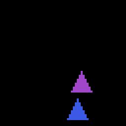
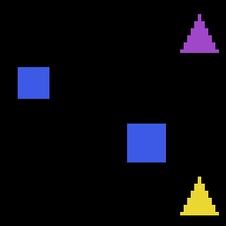
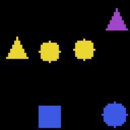
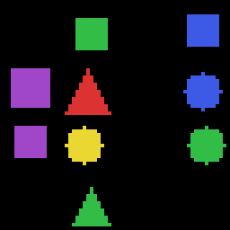

# VLM (Stage 6)

전체 계획은 [로드맵](../2026-10-21-roadmap.md), 눈을 달 언어 모델의 구조는 [GPT 모델](2026-10-21-gpt-model.md), 그 모델을 스스로 개선시킨 과정은 [RSI](2026-10-21-rsi.md) 페이지에 있다. 이 페이지는 `scratchlm/vision.py`와 그가 가져다 쓰는 `tasks.py`의 장면 부분(`scene`, `render`, `question`), `model.py`의 몇 가지 변경을 설명한다.

## 1. VLM이란

VLM은 vision-language model, 곧 "이미지를 보고 말로 답하는 모델"이다. 여기서는 LLaVA 방식을 따른다. 아이디어는 단순하다. **언어 모델은 그대로 두고, 이미지를 언어 모델이 알아듣는 "토큰 같은 벡터"로 바꿔서 글자 토큰 자리에 끼워 넣는다.**

1. 이미지를 작은 조각(patch)으로 자르고, 조각마다 벡터 하나를 만든다. 이 일을 하는 것이 **ViT**(Vision Transformer, 이미지 조각들을 서로 섞어 읽는 트랜스포머)다.
2. **투영기(projector)** 가 ViT의 벡터를 언어 모델의 벡터 크기에 맞춘다. 구조는 `Linear -> silu -> Linear`, 곧 작은 2층 신경망이다 (`silu`는 `x * sigmoid(x)`로, 부드러운 활성화 함수다).
3. 프롬프트에 미리 `<|image|>`라는 **자리표시 토큰**을 64개 넣어 두고, 그 자리의 임베딩(토큰을 벡터로 바꾼 값)을 투영된 이미지 벡터 64개로 **덮어쓴다**. 순서대로 들어가고, `masked_scatter`를 쓴다.
4. 그 뒤는 3~5단계에서 만든 **같은 GPT**가 처리한다. 언어 모델 입장에서는 "이상하게 생긴 토큰 64개가 앞에 있는 글"일 뿐이다.

토큰 순서는 이렇게 생겼다 (`vision.py` 맨 위 설명).

```
<|user|> <|image|> x 64   How many red shapes are there?   <|assistant|>   2   <|endoftext|>
         \_____________/  \______________________________/                \_/
          ViT+투영기 벡터      글자 토큰(원래 임베딩)                         학습할 답
          (임베딩을 덮어씀)
```

코드의 흐름은 `VLM.embed` 한 함수에 다 있다.

```python
x = self.lm.embed(ids)                                   # 글자 토큰 임베딩
f = self.proj2(silu(self.proj1(self.vit(images))))       # (B, 64, d_model) 이미지 벡터
return x.masked_scatter((ids == self.image_id)[..., None], f.to(x.dtype))
```

`tests/test_vision.py`의 `test_image_features_replace_placeholders`가 확인하는 것: 글자 토큰 위치는 임베딩이 그대로이고, `<|image|>` 위치는 바뀌며, 그 값이 이미지에 따라 달라진다.

## 2. 합성 장면

이미지는 직접 만든다. 도형을 그리는 코드는 `numpy`만 쓴다 (`tasks.py`의 `render`). 이미지 라이브러리도, 이미지 데이터셋도 필요 없다.

- 캔버스는 **64x64 픽셀, 검은색**이다 (`IMG = 64`).
- 캔버스를 **4x4 칸**으로 나눈다. 칸 하나가 16픽셀이다 (`GRID = 4`). 도형은 서로 다른 칸에 하나씩 놓으므로 **절대 겹치지 않는다**.
- 색은 5가지(red, green, blue, yellow, purple), 모양은 3가지(circle, square, triangle)다.
- 도형의 반크기 `h`는 5 또는 6픽셀이고, 중심은 칸 한가운데에서 가로·세로로 -1, 0, +1픽셀씩 흔들린다 (jitter).

모양마다 "이 픽셀이 도형 안인가"를 식 하나로 정한다 (`dy`, `dx`는 픽셀과 중심의 세로·가로 차이).

| 모양 | 조건 |
|---|---|
| circle | `dy**2 + dx**2 <= h*h` |
| square | `abs(dy) <= h-1` 그리고 `abs(dx) <= h-1` |
| triangle | `-h <= dy <= h` 그리고 `abs(dx) <= (dy + h) / 2` |

삼각형은 위로 뾰족하다. 맨 위 줄(`dy = -h`)에서 폭이 0이고 아래로 갈수록 한 줄에 반폭이 0.5씩 넓어진다.

**왜 합성 이미지인가.** 장면을 우리가 만들었으니 정답을 **만드는 순간부터 안다**. 정답을 아는 프로그램이 곧 채점기(verifier)다. 5단계 [RSI](2026-10-21-rsi.md)에서 쓴 "프로그램이 채점한다"는 원칙이 그대로 이어진다. 사진 데이터셋은 이런 정답을 가지고 있지 않고, 내려받을 파일과 의존성도 늘어난다.

예시 이미지 네 장이다. 64x64 장면을 4배로 키운 256x256 이미지이며, 도형 수는 2, 4, 6, 9개다.

| 2개 | 4개 |
|---|---|
|  |  |

| 6개 | 9개 |
|---|---|
|  |  |

6개짜리 장면(scene2)에는 오른쪽 위의 보라색 삼각형, 노란색 삼각형, 노란색 원 두 개, 파란색 사각형, 파란색 원이 있다. 이 장면에 대해 측정한 질문과 답은 다음과 같다.

| 질문 | 답 |
|---|---|
| What color is the square? | blue |
| Is there a purple triangle? | yes |
| How many circles are there? | 3 |

(원은 노란 원 2개와 파란 원 1개, 합쳐서 3개다.)

## 3. 질문 5종

`question(rng, objs)`는 0~4 중 하나를 무작위로 골라 질문과 정답 문자열을 함께 돌려준다. 채점은 문자열이 정확히 같은지만 본다.

| 번호 | 이름 | 질문 | 답 |
|---|---|---|---|
| 0 | count_all | How many shapes are there? | 도형 수 |
| 1 | count_color | How many red shapes are there? | 그 색 도형 수 |
| 2 | count_shape | How many circles are there? | 그 모양 도형 수 |
| 3 | exists | Is there a blue circle? | yes / no |
| 4 | color_of | What color is the square? | 색 이름 |

두 가지 설계 때문에 종류별 비율이 균등하지 않다.

- **exists**: 절반의 확률로 장면에 **실제로 있는** 도형을 골라 묻는다. 그렇지 않으면 "yes"가 드물어서 항상 "no"만 말해도 점수가 높아진다.
- **color_of**: 장면에서 **모양이 하나뿐인** 도형이 있을 때만 묻는다 ("the square"가 누구인지 하나로 정해져야 하므로). 그런 도형이 없으면 **count_all 질문으로 대체**된다. 그래서 **count_all이 가장 자주 나오는 질문**이다 (0번이 뽑힐 때 + 4번이 대체될 때). 도형이 많을수록 모양이 겹치기 쉬워서 이 대체가 더 자주 일어난다.

`tests/test_vision.py`의 `test_answers_match_the_scene`이 질문마다 정답이 장면과 맞는지 확인한다.

## 4. ViT

`ViT`는 이미지 한 장을 **64개의 벡터**로 바꾼다.

**조각 내기(patchify).** 8x8 픽셀 조각 64개로 자른다 (`PATCH = 8`, `(64/8)**2 = 64`). 코드의 모양 변화는 다음과 같다.

```
(B, 64, 64, 3)                       # 배치, 세로, 가로, 색(RGB)
reshape -> (B, 8, 8, 8, 8, 3)        # (조각 행, 행 안 픽셀, 조각 열, 열 안 픽셀, 색)
permute(0,1,3,2,4,5) -> (B, 8, 8, 8, 8, 3)   # (조각 행, 조각 열, 행 안 픽셀, 열 안 픽셀, 색)
reshape -> (B, 64, 192)              # 조각 64개, 조각마다 8*8*3 = 192개 숫자
```

`permute`가 하는 일은 "같은 조각에 속한 픽셀을 이웃으로 모으는 것"이다. 이렇게 해야 마지막 `reshape`가 한 조각의 픽셀 192개를 한 줄로 묶는다.

**임베딩과 트랜스포머.**

1. `patch_embed`: `Linear` 192 -> 256. 조각 하나가 256차원 벡터가 된다 (`vit_dim = 256`).
2. `Block` 4개 (`vit_layers = 4`, 머리 수는 `256 // 64 = 4`). 언어 모델에서 쓴 **같은 `Block` 클래스를 재사용**한다. 다른 점은 `Config(causal=False)` 하나뿐이다.
3. 마지막 `RMSNorm`.

**양방향 어텐션.** 언어 모델은 앞 토큰만 볼 수 있다(causal, 인과적). 이미지 조각에는 "앞뒤"가 의미 없으므로 `causal=False`로 모든 조각이 모든 조각을 본다. `test_vit_is_bidirectional`은 맨 마지막 조각 픽셀만 바꿨을 때 **첫 번째 조각의 출력이 달라지는지** 확인한다.

**위치 정보.** 위치는 언어 모델과 똑같이 1차원 RoPE(위치마다 벡터를 돌려서 상대 위치를 알려 주는 방식)로 준다. 조각은 **래스터 순서**(왼쪽에서 오른쪽, 위에서 아래)로 한 줄에 늘어서 있으므로, 2차원 위치(몇 행 몇 열)는 **암묵적으로만** 들어간다. 같은 열의 바로 아래 조각은 항상 8칸 뒤라서 모델이 스스로 알아내야 한다. 실습 1번이 이것을 고쳐 본다.

**크기 (측정값).**

| 항목 | 값 |
|---|---|
| ViT 파라미터 | 3,262,720 |
| 학습 대상 전체 (ViT + 투영기) | 3,655,936 |

둘의 차이 393,216은 투영기 두 `Linear`의 합이다. `Linear`에 편향(bias)이 없으므로 `256 x d + d x d`이고, 이 식이 맞으려면 언어 모델의 `d_model`이 512여야 한다 (이 값은 위 두 측정값에서 거꾸로 계산한 것이다).

## 5. 연결

글자 쪽을 건드린 곳은 세 군데뿐이다.

- **`<|image|>` 토큰 추가.** `chat_tokenizer`가 `<|user|>`, `<|assistant|>`와 함께 `<|image|>`를 기존 id 뒤에 붙인다. 이미 있으면 다시 붙이지 않는다. 그러면 **어휘 크기가 1 늘어난다**. 4단계(SFT)에서 쓴 `load_checkpoint`의 어휘 확장 처리(vocab surgery)를 그대로 재사용해서 언어 모델의 임베딩 행을 늘린다.
- **`GPT.forward`와 `GPT.generate`에 `embeds` 인자.** 주면 `self.embed(ids)` 대신 그 벡터를 쓴다. `ids`는 길이를 알려 주는 용도로 남는다. `generate`는 처음 프롬프트를 한 번에 읽는 단계(prefill)에서만 `embeds`를 쓰고, 이후 새 토큰은 평소처럼 임베딩한다. KV cache도 그대로 쓴다.
- **`causal` 설정과 `silu`.** `Config.causal`이 `False`면 어텐션 마스크를 전부 켠다. `silu`는 SwiGLU 안에 있던 계산을 함수로 꺼내서 SwiGLU와 투영기가 같이 쓴다 (겹치는 코드를 두지 않는다).

**픽셀 정규화.** `to_tensor`는 `uint8` 이미지를 `/255 - 0.5`로 바꿔 -0.5~0.5 범위로 만든다.

## 6. 학습 (A단계: 정렬)

"정렬(alignment)"은 이미지 벡터가 언어 모델이 아는 말로 읽히도록 맞추는 일이다.

- **언어 모델은 얼린다.** `vlm.lm.requires_grad_(False)`로 기울기 계산을 끈다. 학습되는 것은 **ViT와 투영기뿐**이다 (3,655,936개). 시작 모델은 `runs/rsi/r10/ckpt.pt`, 곧 RSI 10라운드를 마친 모델이다.
- **데이터는 매번 새로 만든다.** 한 스텝마다 장면, 질문, 답을 무작위로 128개 뽑는다. 장면의 도형 수는 **1~6개**이고, **7~10개는 학습에서 뺐다**(held out). 평가에서 처음 보는 개수다.
- **토큰 배치.** 한 예제는 `<|user|>` + 이미지 자리 64개 + 질문 + `<|assistant|>` + 답으로 만들고 길이 **L = 96** 토큰으로 `<|endoftext|>`를 채워 맞춘다. 타깃은 답 부분 말고는 모두 -1이다 (-1은 손실 계산에서 무시한다는 뜻). 즉 **손실은 답 토큰에만** 걸린다. 이미지 자리나 질문을 맞히라고 시키지 않는다.
- **하이퍼파라미터.** 배치 128, 학습률 1e-3, 워밍업 200스텝(학습률을 0에서 서서히 올림), 이후 코사인 감소, 총 4000스텝, 그래디언트 클리핑 1.0, bf16 autocast.
- **속도 (측정).** 100스텝에 26초, 약 0.25초/스텝이다.
- **초기 손실 (측정).** 100스텝 1.5866, 200스텝 0.9869.

1000스텝마다와 마지막에 평가를 돌려 로그(`runs/vlm/log.jsonl`)에 남긴다.

## 7. 평가

`evaluate`는 새 장면 1000개를 만든다 (시드 123). 도형 수는 **1, 2, ..., 10을 번갈아** 쓰므로 학습에 없던 7~10개도 정확히 100개씩 들어간다. 각 장면에 질문 하나를 던지고, **greedy**(매 단계 확률이 가장 높은 토큰을 고름)로 최대 3토큰을 생성해 정답 문자열과 비교한다.

- **질문 종류별 정확도**: 위 5종.
- **도형 수별 정확도**: 장면의 도형 수마다, 모든 질문 종류를 합친 정확도.
- **전체 정확도**.

KV cache를 쓰는 `generate`는 한 배치 안의 프롬프트 길이가 같아야 하므로, 프롬프트의 토큰 길이가 같은 것끼리 묶어서 실행한다 (`answer`). 질문 문장이 달라 길이가 다르기 때문이다.

## 8. 결과

A단계 실행 `runs/vlm`(4000스텝, **1027초 ≈ 17분**, PGX GB10)의 측정값이다.

**학습 손실** (답 토큰만): 500스텝 0.678 → 1000스텝 0.551 → 2000스텝 0.324 → 3000스텝 0.296 → 4000스텝 **0.222**. 끝까지 내려가는 중이었다. 학습을 더 하면 나아질 여지가 있다.

**전체 정확도**: 1000스텝 0.508 → 2000스텝 0.534 → 3000스텝 0.581 → 4000스텝 **0.577**.

**질문 종류별 정확도** (1000스텝 → 4000스텝)

| 질문 | 1000 | 4000 |
|---|---|---|
| count_color (특정 색 개수) | 0.582 | **0.774** |
| exists (있나 없나) | 0.725 | 0.758 |
| count_all (전체 개수) | 0.446 | 0.525 |
| color_of (하나뿐인 모양의 색) | 0.376 | 0.504 |
| count_shape (특정 모양 개수) | 0.406 | **0.333** |

**도형 수별 정확도** (4000스텝, 질문 종류 합산)

| 도형 수 | 1 | 2 | 3 | 4 | 5 | 6 | 7 | 8 | 9 | 10 |
|---|---|---|---|---|---|---|---|---|---|---|
| 정확도 | 0.97 | 0.77 | 0.78 | 0.86 | 0.71 | 0.64 | 0.39 | 0.24 | 0.22 | 0.19 |

해석:

- **색은 잘 보고, 모양은 잘 못 본다.** 색 개수 세기(0.77)가 모양 개수 세기(0.33)보다 훨씬 좋다. 색은 픽셀 값 하나로 알 수 있지만 모양은 8x8 조각 안의 픽셀 배치를 읽어야 한다. 모양 개수 정확도는 학습 중에 오히려 떨어졌다(0.41 → 0.33).
- **학습한 범위 밖에서 무너진다.** 1~6개는 0.64 이상인데, 처음 보는 7~10개는 0.39 → 0.19로 떨어진다. 5단계 덧셈의 "학습한 길이 너머 일반화 실패"([교훈](../lessons/2026-10-21-length-generalization.md))가 이미지에서 다시 나타났다. 다음 경계로 삼아 9절에서 RSI를 돌렸다.
- 언어 모델은 얼렸기 때문에 덧셈·이야기 실력은 그대로다 (가중치가 바뀌지 않음).

## 9. 이미지 RSI: 6개 너머로 세기

5단계의 루프(문제 출제 → k개 샘플 → 채점기 통과분만 남김 → 자기 답으로 학습 → 승급)를 그대로 이미지에 옮겼다 (`vision.py`의 `self_improve`). 덧셈의 "자릿수" 자리에 **"장면의 도형 수"**가 들어간다.

### 9.1 출발점 측정

A단계 모델에 장면을 도형 수 1~16개로 300개씩 만들어 물었다 (greedy 1회, 온도 0.7로 8회 샘플).

- **"How many shapes are there?"(전체 개수)**: 1~6개에서 greedy 1.00, 7개에서 0.01, 8개 이상 0.00. **6보다 큰 숫자를 거의 말하지 않는다.** 덧셈의 "학습한 길이에서 멈춤"과 같은 벽이다.
- 같은 질문의 pass@8(8번 중 하나라도 맞음)은 7개 0.12, 8개 0.02, 9개 이상 0.00이었다. 7개는 출발할 수 있다.
- **함정: 답이 짧다.** 덧셈의 답은 17자리라 운으로 맞을 일이 없었다. 여기 답은 "7", "yes", "red"처럼 한두 토큰이다. 예를 들어 "몇 개의 원?"(count_shape)은 greedy 0.25~0.60인데 pass@8은 0.80~0.95였다 (1~6개). 8번 찍으면 대개 하나는 맞는다. **"하나라도 맞으면 통과"로 두면, 채점기가 사실상 정답 라벨을 몰래 건네주는 셈이다.**

### 9.2 세 가지 필터 비교

그래서 같은 루프를 필터만 바꿔 세 번 돌렸다.

| 실행 | 학습에 남기는 문제 |
|---|---|
| `majority` (기본) | 8개 샘플의 **다수결 답**이 정답일 때만 (다른 어떤 답보다 표가 많아야 함, 동률은 탈락) |
| `any` | 하나라도 맞으면 (5단계 덧셈과 같은 필터) |
| `oracle` (대조군) | 출제한 문제 전부를 **진짜 정답 라벨**로. RSI가 아니라 그냥 지도학습 |

설정은 셋 다 같다. 언어 모델은 고정하고 ViT + 투영기만 학습했다. 라운드마다 문제 40,000개를 냈다(절반은 frontier 도형 수, 절반은 1 ~ frontier−1개 복습). k=8, 온도 0.7, 300스텝 x 배치 128, lr 3e-4. 승급 조건은 frontier 개수에서 "전체 개수" greedy 정확도 ≥ 0.9이고, 출발 frontier는 7이다. 평가는 도형 1~16개 x 250장면(시드 123)이다. 세 실행을 동시에 돌려 라운드당 약 15분, 실행당 10라운드 약 2.5시간 걸렸다.

**"전체 개수" greedy 정확도, 도형 수 7~16 (10라운드 후)**

| 실행 | 7 | 8 | 9 | 10 | 11 | 12 | 13 | 14 | 15 | 16 | 도달한 frontier |
|---|---|---|---|---|---|---|---|---|---|---|---|
| 출발 (A단계) | 0.00 | 0 | 0 | 0 | 0 | 0 | 0 | 0 | 0 | 0 | 7 |
| majority | 0.93 | **1.00** | 0 | 0 | 0 | 0 | 0 | 0 | 0 | 0 | 9에서 멈춤 (라운드 7~10) |
| any | 0.97 | 0.93 | **1.00** | 0 | 0 | 0 | 0 | 0 | 0 | 0 | 10에서 멈춤 (라운드 7~10) |
| oracle | 0.96 | 0.93 | 0.87 | 0.93 | 0.93 | 0.93 | 0.95 | 0.93 | 0.62 | 1.00 | 16 (라운드마다 1칸) |

(출발 행의 7은 이 평가 세트에서 0.000. 1~6개의 "전체 개수"는 세 실행 모두 라운드 내내 0.86 이상, 10라운드 후 0.955 이상이었다.)

**전체 정확도 (질문 5종, 도형 1~16개)**: 출발 0.385 → majority 0.525, any 0.572, oracle 0.742.
질문 종류별로 "몇 개의 원/사각형/삼각형?"(count_shape)은 세 실행 모두 0.23~0.30에서 움직이지 않았다. 정답 라벨(oracle)을 줘도 마찬가지였다.

### 9.3 왜 멈췄나: 탐색의 벽

frontier가 F로 올라간 첫 라운드에, F개짜리 장면의 "전체 개수" 질문 약 5,700~7,000개 중 **다수결로 맞힌 문제 수**는 다음과 같다.

| 새 frontier | majority 실행 | any 실행 |
|---|---|---|
| 7 (출발) | 35 | 35 |
| 8 | 363 | 10 |
| 9 | **0** | 1 (any-correct는 그보다 많아서 학습됨 → 9개 0.77) |
| 10 | — | **0** |

- **모델이 한 번도 말하지 않는 답은 RSI가 만들어 낼 수 없다.** 채점기는 고를 뿐 가르치지 않는다. 샘플 안에 정답이 없으면(pass@k = 0) 학습 데이터가 0이고, 그 frontier에서 라운드를 반복해도 그대로다 (majority 라운드 7~10, any 라운드 7~10). 4단계에서 "pass@16이 0이면 RSI를 시작할 수 없다"고 했던 조건이 이번에는 중간에서 걸렸다.
- **덧셈은 왜 16자리까지 갔나.** 덧셈의 답은 자리마다 "두 숫자 + 올림"이라는 **같은 규칙**을 반복한다. 자리가 하나 늘어도 새로 배울 것은 거의 없다. 개수 세기의 답 "9"는 **통째로 새로운 출력**이다. "8까지 셀 줄 안다"가 "9라고 말할 줄 안다"로 이어지지 않는다. 7과 8은 조금 새어 나왔지만(위 표의 35, 363) 9부터는 0이었다.
- **필터가 엄격할수록 일찍 멈춘다.** any는 운 좋은 한 표도 받아 줘서 majority보다 한 칸 더 갔다(10). 다만 frontier에서 "8개 중 정확히 1개 맞음" 비율(lucky)은 라운드 1에 0.12, any 실행의 이후 라운드에 0.02~0.07이었다. 운이 섞인 학습이었다는 뜻이다.
- **oracle은 라운드마다 정확히 한 칸씩 갔다.** 라벨만 있으면 이 모델·데이터로 16까지 셀 수 있다. 막힌 것은 지각 능력이 아니라 탐색이다. 다만 oracle에서도 막 frontier였던 개수는 1.00인데 바로 아래 개수는 낮은 경우가 있었다(라운드 10: 15개 0.62, 16개 1.00). 학습 문제의 절반이 frontier 개수라서 그 숫자 쪽으로 쏠린 것으로 보인다 (추정).
- **모양 세기는 RSI로도 지도학습으로도 안 됐다.** 이건 탐색 문제가 아니라 눈(ViT)의 문제다. 4절의 1차원 위치·8x8 조각 한계와 연결된다 (실습 1, 3).

## 10. 나눠서 세기: 탐색의 벽 넘기

9절의 결론은 "모델이 한 번도 말하지 않는 답은 RSI가 만들 수 없다"였다. 해결책은 답을 **이미 아는 조각들의 조합**으로 바꾸는 것이다. 덧셈이 16자리까지 간 이유(같은 규칙의 반복)를 개수 세기에 일부러 만들어 준다.

### 10.1 답의 형식: 줄별 개수의 누적합

`--rows true`이면 "How many shapes are there?"의 답이 숫자 하나가 아니라 **줄(행)마다 개수를 더해 가는 식**이 된다 (`tasks.py`의 `chain`, `row_counts`).

```
장면 (4x4 칸):        답
  ● ▲ . ■   -> 3
  . ● . ▲   -> 2      "3+2=5+4=9+1=10"
  ■ ● ▲ ●   -> 4
  . . ▲ .   -> 1
```

- 줄 하나의 개수는 0~4이다. 한 걸음은 "작은 수 하나 더하기"뿐이라서, 도형이 몇 개든 **새로 배울 숫자 조각이 없다**. 마지막 합(10)만 새 숫자인데, 그것도 앞 합(9)에 작은 수를 더한 결과다.
- 채점은 마지막 합이 진짜 개수와 같은지로 한다 (문자열 전체 일치). `parse_chain`은 평가에서 형식이 맞는지(well_formed), 덧셈이 맞는지(arith_ok), 줄 개수가 맞는지(row_ok)를 따로 잰다.
- **덧셈은 따로 가르쳤다.** 5단계의 덧셈 능력이 이 형식으로 옮겨 갈 거라고 기대하지 않았다. 형식(0으로 채운 16자리, 거꾸로 쓴 답)이 전혀 다르기 때문이다. 대신 `--drill 0.25`로 학습 문제의 25%를 빈 이미지 + "What is 3+2+4+1?" → "3+2=5+4=9+1=10" 같은 **텍스트 덧셈 연습**으로 채웠다 (`sum_question`). 줄 개수는 0~4 무작위라서 합은 16까지 나온다.

### 10.2 B단계 학습 결과와 대조군

A단계 VLM(`runs/vlm`)에서 출발해 **언어 모델까지 풀고**(`--freeze_lm false`, lr 1e-4) 4000스텝 학습했다. 학습 장면은 여전히 도형 1~6개뿐이다.

| 실행 | 답 형식 | 학습 문제 | 7개 | 8개 | 9개 | 10개 | 11개 | 12개 이상 |
|---|---|---|---|---|---|---|---|---|
| `vlm_rows` | 줄별 누적합 | 장면 75% + 텍스트 덧셈 25% | **1.00** | **1.00** | 0.71 | 0.36 | 0.25 | 0 |
| `vlm_rows_ctrl` (대조군) | 숫자 하나 | 같은 섞음 (텍스트 덧셈 포함) | 0 | 0 | 0 | 0 | 0 | 0 |

("전체 개수" greedy 정확도, 4000스텝, 도형 수별 평가. 1~6개는 두 실행 모두 1.00.)

- **대조군이 핵심이다.** 대조군은 텍스트 덧셈 문제를 똑같이 보고, 언어 모델도 똑같이 풀었다. 다른 것은 "How many shapes"의 답 형식 하나뿐이다. 대조군은 7개 이상에서 끝까지 0이었다. 그러니 벽을 넘긴 것은 "큰 숫자를 많이 봐서"(노출)가 아니라 **답을 조각으로 나눈 것(조합)**이다.
- 7, 8개짜리 장면은 **한 번도 학습하지 않았는데** 1.00이다. RSI 없이 형식만으로 학습 범위를 넘었다.
- **어디서 무너지나**: 줄 개수 정확도(row_ok)는 진짜 개수 0~3인 줄에서 0.97~0.99, **4인 줄에서 0.87**이었다. 도형 1~6개 장면에서 한 줄에 4개가 다 찬 경우는 줄 전체의 0.19%(3개는 3.4%)라서 거의 본 적이 없다. 도형이 많을수록 꽉 찬 줄이 늘어서 정확도가 떨어진다. 12개부터는 식의 형식 자체가 깨지기 시작했다(well_formed 12개 0.84, 13개 0.065). 13개 이상은 꽉 찬 줄이 반드시 하나 이상 있어야 하는 개수다.

### 10.3 잊어버림과 텍스트 복습

언어 모델을 풀었더니 **5단계 실력이 사라졌다**. 학습 전에는 덧셈 정확도(4/8/12/16자리)가 1.0/1.0/0.995/1.0이고, 이야기 과제의 "주어진 단어 사용률"이 0.523이었다.

| 실행 | 덧셈 4 / 8 / 12 / 16자리 | 이야기 단어 사용률 | 7개 | 8개 | 9개 |
|---|---|---|---|---|---|
| 학습 전 (5단계 모델) | 1.0 / 1.0 / 0.995 / 1.0 | 0.523 | — | — | — |
| `vlm_rows` | **0 / 0 / 0 / 0** | 0.023 | 1.00 | 1.00 | 0.71 |
| `vlm_rows_ctrl` | 0 / 0 / 0 / 0 | 0.003 | 0 | 0 | 0 |
| `vlm_rows_replay` (텍스트 복습) | **1.0 / 0.995 / 0.995 / 0.94** | **0.640** | 1.00 | 0.52 | 0.12 |

- **파국적 망각(catastrophic forgetting)**: 새 과제의 기울기만 받으면, 옛 과제에 쓰이던 가중치가 아무 거리낌 없이 덮어써진다. 4000스텝이면 충분했다.
- **해결: 복습**. `--text data/sft_train.bin`을 주면 스텝마다 4단계 SFT 데이터(이야기 + 덧셈 대화)의 배치 16개를 함께 보고, 그 손실을 이미지 손실에 **더한다** (`fit`의 `text` 인자). 옛 과제의 기울기가 계속 들어오니 가중치가 그쪽도 지킨다.
- 결과는 거의 완전한 보존이었다. 이야기 단어 사용률은 오히려 0.523 → 0.640으로 올랐다 (SFT 데이터를 더 본 효과로 추정).
- **대가**: 같은 4000스텝에서 큰 개수 세기는 덜 됐다 (8개 1.00 → 0.52, 9개 0.71 → 0.12). 학습 신호의 일부가 복습에 쓰였기 때문이다. 이 빈칸은 다음 절의 RSI가 채운다.

### 10.4 줄별 세기 + RSI

9절과 같은 루프를 줄별 형식으로 돌렸다 (`vrsi_rows`: `vlm_rows`에서 출발, 언어 모델도 학습, 필터 `any`, 라운드당 문제 20,000개 = frontier 절반 + 복습 절반(그중 25%는 텍스트 덧셈), 300스텝, lr 1e-4, `--max_new 16`). 출발 frontier는 "전체 개수"가 0.9 미만인 첫 개수 9였다.

| 라운드 | frontier | frontier 샘플 pass@1 / pass@8 | 9개 | 10개 | 11개 | 12개 | 13개 | 14개 | 15개 | 16개 | 전체 |
|---|---|---|---|---|---|---|---|---|---|---|---|
| 0 (출발) | 9 | — | 0.72 | 0.35 | 0.27 | 0.05 | 0 | 0 | 0 | 0 | 0.545 |
| 1 | 9 | 0.74 / 0.84 | **1.00** | 0.87 | 0.51 | 0.14 | 0.05 | 0 | 0 | 0 | 0.611 |
| 2 | 10 | 0.87 / 0.94 | 1.00 | **1.00** | 0.16 | 0.10 | 0.43 | 0.57 | 0 | 0 | 0.644 |
| 3 | 11 | **0.14 / 0.25** | 1.00 | 1.00 | **1.00** | **1.00** | **0.99** | **0.99** | **1.00** | **0.97** | 0.759 |
| 4~8 | 12 → 16 | 1.00 / 1.00 | 9~16개 모두 0.96~1.00 | | | | | | | | 0.755~0.769 |

(9~16개의 "전체 개수" greedy 정확도. 라운드 6, 7에서는 1~16개 전부 1.00. "전체"는 질문 5종 x 도형 1~16개.)

- **벽이 사라졌다.** 숫자 하나로 답할 때는 `any` 필터가 10에서 멈췄고, 정답 라벨(oracle)을 줘도 라운드마다 한 칸씩만 갔다 (9.2절). 줄별 형식에서는 6라운드 만에 1~16개가 모두 1.00이 됐다. 전체 정확도는 0.769였다. 다만 9.2절의 실행들과 조건이 다르다. 이 실행은 언어 모델도 학습했고, 이미 7·8개를 세는 `vlm_rows`에서 출발했으며, 라운드당 문제가 절반(20,000개)이다. 그러니 이 표는 "벽이 사라졌다"는 근거이고, 전체 정확도의 직접 비교는 아니다.
- **라운드 3이 결정적이었다.** frontier 11에서 샘플은 14%만 맞았다(pass@8 0.25). 그런데 그 맞은 답으로 학습하자 **학습하지 않은 12~16개까지 한꺼번에 풀렸다**. 11개 장면은 약 65%에 꽉 찬 줄(4)이 있다 (16칸에 11개를 놓는 4,368가지 중 꽉 찬 줄이 없는 배치는 3+3+3+2의 1,536가지뿐). 그래서 11개를 맞히려면 대개 꽉 찬 줄을 제대로 세야 하고, 그 기술은 12~16개에도 그대로 쓰인다 (13개 이상은 꽉 찬 줄이 반드시 있다). 줄 개수 정확도(4인 줄)는 0.89 → 0.96 → 0.98 → **1.00**이었다. 조각 하나를 고치니 모든 개수가 따라왔다.
- **라운드 2의 이상한 모양**: 11, 12개는 0.16, 0.10인데 13, 14개는 0.43, 0.57이다. 꽉 찬 줄을 세는 법이 막 생기는 중이었다고 본다 (추정). 이 형식에서는 "개수"보다 "어떤 줄 패턴이 들어 있나"가 난이도를 정한다.
- **필터가 덜 중요해졌다.** 답이 길어서 운으로 맞을 일이 거의 없다. frontier의 lucky 비율(8개 중 정확히 1개 맞음)은 0~0.06이었다.
- **모양 세기는 여전히 0.28~0.30**이다. 이 형식은 "전체 개수"에만 썼고, 모양 구분이라는 눈의 한계는 그대로다.
- `vrsi_rows`는 `vlm_rows`에서 출발했으므로 이미 덧셈·이야기를 잊은 상태다 (12라운드 후에도 덧셈 0, 이야기 단어 0.0).

### 10.5 복습 + RSI: 둘 다 갖춘 모델

`vrsi_rows_replay`는 `vlm_rows_replay`(덧셈을 지킨 모델, 8개 0.52)에서 출발해 같은 RSI를 돌리면서, 학습 스텝마다 SFT 텍스트 배치를 손실에 더했다 (`--text data/sft_train.bin`). 나머지 설정은 10.4절과 같다.

| 라운드 | frontier | frontier pass@1 | 8개 | 9개 | 10개 | 11개 | 12개 | 13개 | 14개 | 15개 | 16개 |
|---|---|---|---|---|---|---|---|---|---|---|---|
| 0 (출발) | 8 | — | 0.51 | 0.06 | 0 | 0 | 0 | 0 | 0 | 0 | 0 |
| 1 | 8 | 0.40 | 1.00 | 0.94 | 0.46 | 0.61 | 0.22 | 0.01 | 0 | 0 | 0 |
| 3 | 10 | 0.30 | 1.00 | 1.00 | 1.00 | 0.01 | 0.10 | 0.09 | 0.52 | 0 | 0 |
| 4 | 11 | **0.02** | 1.00 | 1.00 | 1.00 | 0.79 | 0.68 | 0.77 | 0.63 | 0.07 | 0 |
| 5 | 11 | 0.83 | 1.00 | 1.00 | 1.00 | 1.00 | 0.78 | 0.70 | 0.84 | 0.79 | 0.20 |
| 6 | 12 | 0.73 | 1.00 | 1.00 | 1.00 | 1.00 | 1.00 | 0.96 | 0.82 | 0.99 | 1.00 |
| 8~12 | 14 → 16 | 0.88~1.00 | 1~16개 모두 1.00 | | | | | | | | |

| | 덧셈 4 / 8 / 12 / 16자리 | 이야기 단어 사용률 | "전체 개수" 1~16개 | 전체 정확도 |
|---|---|---|---|---|
| 5단계 모델 (출발점의 언어 모델) | 1.0 / 1.0 / 0.995 / 1.0 | 0.523 | — | — |
| `vrsi_rows` (복습 없음) | 0 / 0 / 0 / 0 | 0.0 | 모두 1.00 | 0.769 |
| **`vrsi_rows_replay`** | **1.0 / 0.995 / 0.99 / 0.83** | **0.507** | **모두 1.00** | 0.771 |

- **한 모델이 세 가지를 다 한다**: 이미지 속 도형 1~16개 세기, 16자리 덧셈(0.83), 이야기 쓰기. RSI를 끝까지 돌려도 복습이 옛 실력을 지켰다. 16자리 덧셈만 0.94 → 0.83으로 조금 내려갔다.
- 출발점이 더 약했는데(8개 0.51) 라운드 8에 같은 끝(1~16개 1.00)에 도착했다. 라운드 4에서 frontier 11의 샘플 정답률이 **2%뿐**(pass@1 0.019)이었는데도 멈추지 않았고, 다음 라운드에 11개가 1.00이 됐다.
- 라운드가 더 짧았다(약 290~640초 대 560~1140초). 다른 실행과 GPU를 나눠 쓴 시간이 달라서 생긴 차이로 보인다 (추정).

## 11. 참고 구현 비교 표

나중에 참고 구현들과 비교할 예정이다. 이 코드의 선택만 기록하고 참고 구현 열은 비워 둔다.

| 설계 선택 | 이 코드 | 참고 구현 |
|---|---|---|
| 연결 방식 | 자리표시 토큰 64개의 임베딩을 투영된 이미지 벡터로 덮어씀 (LLaVA 방식) | 나중에 비교 (TBD) |
| 이미지 인코더 | ViT, 조각 8x8, 4층, 256차원, 4머리, 양방향 | 나중에 비교 (TBD) |
| 위치 정보 | 래스터 순서 1차원 RoPE | 나중에 비교 (TBD) |
| 투영기 | Linear -> silu -> Linear (편향 없음) | 나중에 비교 (TBD) |
| 이미지 | 64x64 합성 장면, 4x4 칸, 도형 1~10개 | 나중에 비교 (TBD) |
| 학습 | A단계: 언어 모델 고정, ViT + 투영기 학습. 이후 이미지 RSI(같은 파라미터) | 나중에 비교 (TBD) |
| 이미지 RSI 필터 | 다수결(기본) / 하나라도 맞음 / 정답 라벨(대조군) | 나중에 비교 (TBD) |
| 개수 답 형식 | 숫자 하나(기본) / 줄별 누적합 `3+2=5+4=9+1=10` (`--rows`) | 나중에 비교 (TBD) |
| 잊어버림 방지 | 언어 모델을 풀 때 SFT 텍스트 배치를 손실에 더함 (`--text`) | 나중에 비교 (TBD) |
| 손실 | 답 토큰에만 | 나중에 비교 (TBD) |
| 하이퍼파라미터 | 배치 128, lr 1e-3, 워밍업 200, 코사인, 4000스텝 | 나중에 비교 (TBD) |
| 평가 | 질문 5종 x 도형 수 1~10, greedy, 문자열 일치 | 나중에 비교 (TBD) |

## 12. 실습

1. **2차원 위치**: 1차원 RoPE 대신 2차원 RoPE(머리 차원의 절반은 행, 절반은 열에 쓴다)나 학습되는 2차원 위치 임베딩(행 8개 + 열 8개)을 넣어 보자. 정확도, 특히 개수 세기가 좋아지는가? 4절에서 말한 "2차원 위치는 암묵적일 뿐"이라는 점을 시험하는 실험이다.
2. **B단계: 언어 모델도 풀기** (10.3절에서 한 번 해 봄: 복습 없이는 덧셈이 0이 됨): `--freeze_lm false`로 언어 모델까지 같이 학습하고 A단계와 비교하라. 정확도가 오르는가? 학습 후 5단계의 덧셈 정확도는 떨어지지 않는가 (잊어버림)?
3. **조각 크기 4 대 8**: `PATCH`를 4로 바꾸면 이미지 토큰이 256개가 된다. `N_PATCHES`, 자리표시 토큰 수, `L`, 언어 모델의 `ctx_len`을 함께 바꿔야 한다. 비용 대비 정확도는 어떤가?
4. **"어디에" 질문 추가**: "Where is the red circle?" -> "top-left" 같은 위치 질문을 `question`에 더해 보자. 4x4 칸을 4등분하면 답을 정할 수 있다. 위치 질문은 2차원 위치 정보(실습 1)에 얼마나 민감한가?
5. **탐색의 벽 넘기 (9절, 10절에서 누적합 형식으로 해 봄)**: 답을 통째로 말하는 대신 **나눠서 세게** 해 보자. 예: "row counts 3 2 4 1, total 10". 줄마다 개수는 4 이하(이미 아는 숫자)이고, 합은 5단계에서 완벽해진 덧셈이 한다. 그러면 새 개수의 답도 아는 조각들의 조합이 되어 RSI가 계속 갈 수 있는가?
6. **온도**: 샘플 온도를 0.7에서 1.0~1.5로 올리면 frontier 9에서 정답이 한 번이라도 나오는가? 다수결 필터와는 어떻게 부딪히는가?

## 13. 실행

```bash
# VLM 학습을 분리된 컨테이너에서 실행 (이름 vlm)
DETACH=vlm scripts/pgx.sh python -m scratchlm.vision --name vlm

# 진행 로그 보기
ssh pgx docker logs -f vlm
```

```bash
# 이미지 RSI (필터: majority / any / oracle)
DETACH=vrsi_majority scripts/pgx.sh python -m scratchlm.vision rsi --name vrsi_majority --filter majority
```

```bash
# 줄별 세기 B단계 (언어 모델도 학습, 텍스트 덧셈 25%, SFT 텍스트 복습)
DETACH=vlm_rows_replay scripts/pgx.sh python -m scratchlm.vision --name vlm_rows_replay --vlm runs/vlm/ckpt.pt \
  --freeze_lm false --lr 1e-4 --rows true --drill 0.25 --max_new 16 --eval_max 16 --text data/sft_train.bin
# 줄별 세기 RSI
DETACH=vrsi_rows scripts/pgx.sh python -m scratchlm.vision rsi --name vrsi_rows --vlm runs/vlm_rows/ckpt.pt \
  --freeze_lm false --lr 1e-4 --rows true --drill 0.25 --count_only true --max_new 16 --filter any --problems 20000 --rounds 12
```

`--init`의 기본값이 `runs/rsi/r10/ckpt.pt`이므로 5단계 결과가 PGX에 있어야 한다. 로그와 체크포인트는 `runs/vlm/`에 쌓인다. 테스트는 `scripts/pgx.sh python -m unittest -v`.
